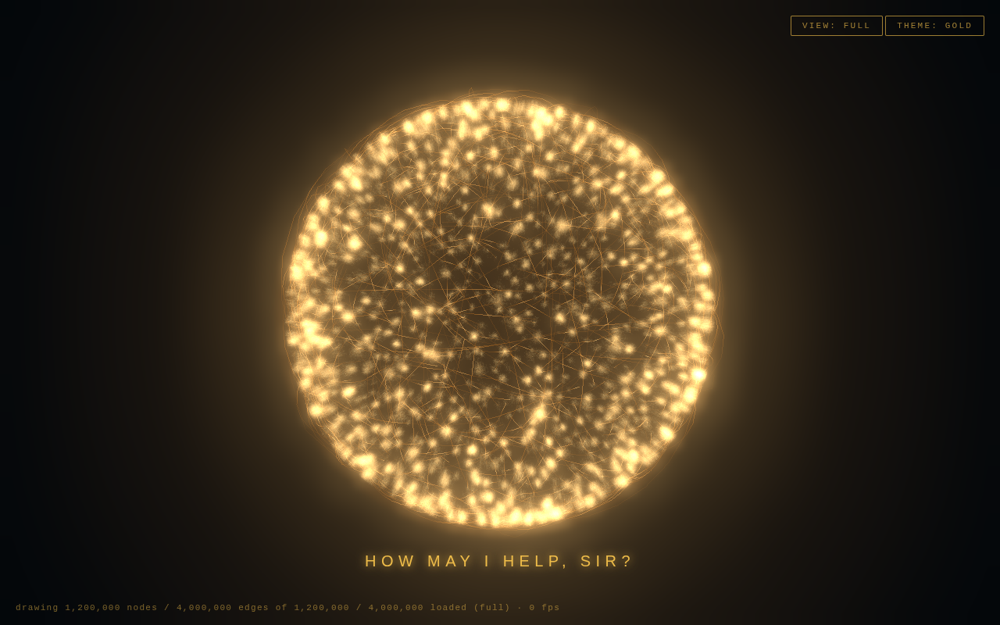
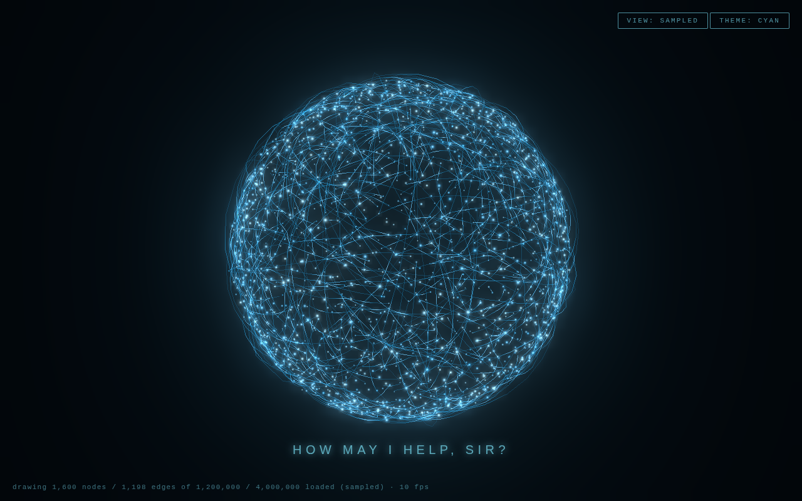
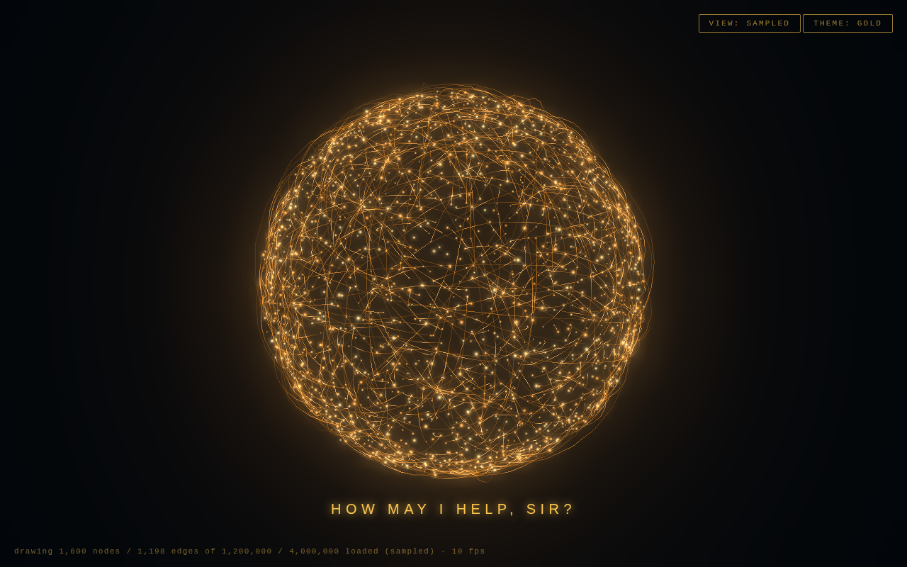

# J.A.R.V.I.S. graph orb

A rotating 3D sphere of glowing graph nodes and edges (Vite + TypeScript + three.js), with additive glow/bloom, pulsing, drag-to-rotate, scroll-to-zoom, and a switchable cyan/gold theme.

| | Cyan | Gold |
| --- | --- | --- |
| Full graph (default) |  |  |
| Sampled (`S`) |  |  |

## Run

```bash
npm install
npm run dev          # http://localhost:5173
npm run build        # typecheck + production bundle
npm run generate:mock                 # optional: dump the mock graph to data/generated/mock-graph.ndjson (gitignored)
npm run generate:mock -- 7 50000 200000   # seed, node count, edge count
```

Drag to rotate, scroll to zoom. `T` (or the button) toggles the theme, `S` (or the button) toggles full vs. sampled view; `?view=sampled` starts in the sampled view.

## Scale and rendering

The mock graph is **1,200,000 nodes and 4,000,000 edges** (seed 1138, heavy-tailed degrees via preferential attachment, fully deterministic). It is generated in memory at page load; nothing large is committed or fetched. `npm run generate:mock` writes the same graph as streamed NDJSON (about 330 MB, ~6 s) to the gitignored `data/generated/`.

**Full view (default)** draws every node and every edge:

- Nodes: one `THREE.Points` with 1.2M vertices.
- Edges: one instanced `LineSegments` (4M instances x 4 segments). Each instance carries only its two node indices; the vertex shader fetches the endpoints from a float texture of node positions and bends the great-circle arc on the GPU.
- Layout (`src/layout.ts`) is linear-time, with no force simulation over the whole graph: the sampled hub skeleton is force-laid-out on the sphere, then a few sweeps over the edge list drop each remaining node near an already placed neighbour, and isolated nodes get a seeded spot. Positions stay out of the data.
- Long edges fade out so local structure reads. The hub backbone (the sampled edges) is overlaid on top.

**Sampled view (`S`)** draws only the connected hub-centred subgraph (at most **1,600 nodes / 3,600 edges**, `DEFAULT_LIMITS` in `src/sample.ts`; about 1,600 / 1,200 for the mock), for low-end machines. The footer shows drawn vs. loaded counts and the live frame rate.

Measured in headless Chrome on a 4-core cloud VM with **no GPU** (SwiftShader software WebGL), so frame rates are a floor, not representative of real hardware:

| | Time / rate |
| --- | --- |
| Generate mock graph (`getGraph`) | ~0.8 s |
| Index + sample + layout | ~1.0 s + 0.03 s + 1.4 s |
| Load to first full-view frame (incl. GPU upload, first frame) | ~65 s |
| Full view | ~0.02 fps (about one frame per minute) |
| Sampled view | ~10 fps |
| JS heap | ~380 MB |

On software rendering even the 1.2M points alone run at ~2 fps, so the full view needs a real GPU. Its per-frame cost is 32M line vertices plus 1.2M points, plus additive fill and bloom. If it is too slow on your hardware, the main levers are fewer arc segments (`FULL_ARC_SEGMENTS` in `src/orb.ts`, 4 to 1 = straight chords), drawing only short or nearby edges, a lower render resolution, or rendering the static full graph once into a texture and rotating that. The sampled view is the fallback.

## Layout

- `src/data/types.ts` – `GraphData` and the `GraphDataSource` interface (`getGraph(): Promise<GraphData>`). The renderer depends only on this.
- `src/data/MockDataSource.ts` / `mockGenerator.ts` – builds the seeded mock graph in memory (nodes: `id/type/label`, edges: `source/target/type`). Nothing large is committed or fetched.
- `src/model.ts` – turns `GraphData` into typed arrays (node indices, degrees, type tint, positions) for the GPU.
- `src/sample.ts` – picks the hub-centred subgraph used by the sampled view and as the layout skeleton.
- `src/data/TigerGraphDataSource.ts` – stub calling a GSQL query over REST++.
- `src/data/index.ts` – `createDataSource()`, the one place a backend is chosen.
- `src/layout.ts` – deterministic sphere layout: force layout for the skeleton, linear neighbour placement for everything else (positions are not part of the data).
- `src/orb.ts` – three.js scene, full and sampled views, shaders, bloom, input.

## Connecting TigerGraph

1. Install a GSQL query that returns one result object `{ nodes: [{id,type,label}], edges: [{source,target,type}] }`, e.g. named `jarvis_graph`.
2. Copy `.env.example` to `.env.local` and set:
   ```
   VITE_DATA_SOURCE=tigergraph
   VITE_TG_HOST=https://<your-instance>
   VITE_TG_GRAPH=<graph name>
   VITE_TG_QUERY=jarvis_graph
   VITE_TG_TOKEN=<token, optional>
   ```
3. Finish `toGraphData()` in `src/data/TigerGraphDataSource.ts` if your query's output differs from the shape above (TigerGraph returns vertices as `v_id`/`v_type`/`attributes`).

Both views work for any source, so a large TigerGraph result renders the same way. No rendering code changes are needed. For other backends, implement `GraphDataSource` and return it from `createDataSource()`. Note that `VITE_*` variables are bundled into the client, so for production proxy TigerGraph through a server rather than shipping a token to the browser.
