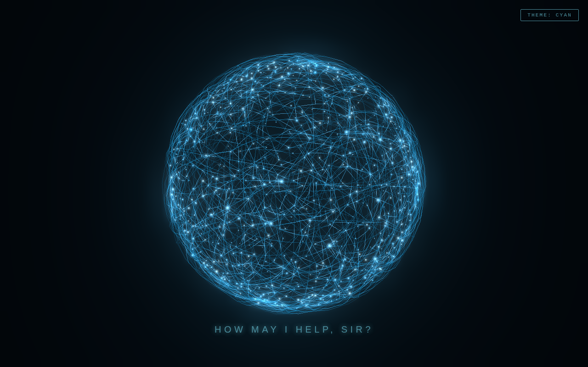

# J.A.R.V.I.S. graph orb

A rotating 3D sphere of glowing graph nodes and edges (Vite + TypeScript + three.js), with additive glow/bloom, pulsing, drag-to-rotate, scroll-to-zoom, and a switchable cyan/gold theme.

| Cyan | Gold |
| --- | --- |
|  |  |

## Run

```bash
npm install
npm run dev          # http://localhost:5173
npm run build        # typecheck + production bundle
npm run generate:mock -- 1138   # regenerate src/data/mock-graph.json from a seed
```

Drag to rotate, scroll to zoom, press `T` (or the button) to toggle the theme.

## Layout

- `src/data/types.ts` – `GraphData` and the `GraphDataSource` interface (`getGraph(): Promise<GraphData>`). The renderer depends only on this.
- `src/data/MockDataSource.ts` – serves the seed-generated `mock-graph.json` (nodes: `id/type/label`, edges: `source/target/type`).
- `src/data/TigerGraphDataSource.ts` – stub calling a GSQL query over REST++.
- `src/data/index.ts` – `createDataSource()`, the one place a backend is chosen.
- `src/layout.ts` – deterministic force layout projected onto the sphere (positions are not part of the data).
- `src/orb.ts` – three.js scene, shaders, bloom, input.

## Connecting TigerGraph

1. Install a GSQL query that returns one result object `{ nodes: [{id,type,label}], edges: [{source,target,type}] }`, e.g. named `jarvis_graph`.
2. Copy `.env.example` to `.env.local` and set:
   ```
   VITE_DATA_SOURCE=tigergraph
   VITE_TG_HOST=https://<your-instance>
   VITE_TG_GRAPH=<graph name>
   VITE_TG_QUERY=jarvis_graph
   VITE_TG_TOKEN=<token, optional>
   ```
3. Finish `toGraphData()` in `src/data/TigerGraphDataSource.ts` if your query's output differs from the shape above (TigerGraph returns vertices as `v_id`/`v_type`/`attributes`).

No rendering code changes are needed. For other backends, implement `GraphDataSource` and return it from `createDataSource()`. Note that `VITE_*` variables are bundled into the client, so for production proxy TigerGraph through a server rather than shipping a token to the browser.
